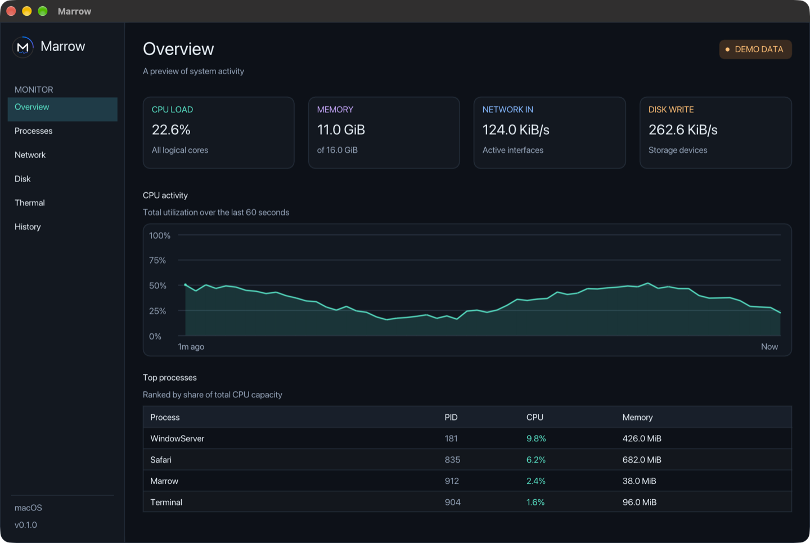
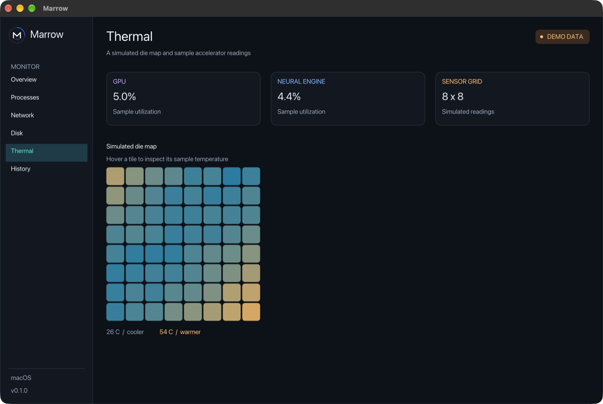

<p align="center">
  
</p>

# Marrow

A macOS system monitor with a live dashboard, local CPU history, and terminal exports. It runs in your user session without a privileged helper.

[Download the latest release](https://github.com/DevAriwala2712/Marrow/releases/latest) · macOS 13+ · Apple silicon and Intel



## Install from Terminal

```sh
curl -fsSLo marrow-install.sh https://github.com/DevAriwala2712/Marrow/releases/latest/download/install.sh
bash marrow-install.sh
open "$HOME/Applications/Marrow.app"
```

The installer checks the archive's SHA-256 and app signature, then installs to `~/Applications` and links `marrow-cli` in `~/.local/bin`. Run the same commands to upgrade. The release uses an ad hoc signature and is distributed without Apple notarization.

## What Marrow shows

- **Overview** shows CPU utilization, physical memory, network receive rate, disk write rate, and top processes.
- **Processes** filters visible processes by name or PID and shows CPU share, resident memory, and parent IDs.
- **Network and Disk** show aggregate throughput. Disk rates depend on the counters exposed by your storage drivers.
- **Thermal** shows the thermal pressure macOS reports. The die map and accelerator figures are available as simulated readings in demo mode.
- **History** stores up to 30 minutes of CPU samples locally. Choose a 1, 5, or 30-minute window and hover the graph to inspect a sample.

Both screenshots show demo data. To try it, launch Marrow with `--demo`.

```sh
open -n "$HOME/Applications/Marrow.app" --args --demo
```

<details>
<summary>Thermal demo screenshot</summary>



</details>

## Terminal metrics

```sh
export PATH="$HOME/.local/bin:$PATH"
marrow-cli
marrow-cli --format prometheus
```

The CLI takes a live snapshot each time it runs. JSON includes CPU, memory, network, disk, and thermal pressure when available. Prometheus text output includes CPU user percentage and used memory.

## Build from source

Install the Xcode Command Line Tools and CMake 3.24 or later. CMake fetches pinned versions of GLFW, Dear ImGui, and nlohmann/json at configure time.

```sh
git clone https://github.com/DevAriwala2712/Marrow.git
cd Marrow
make test
open build/Marrow.app
./build/marrow-cli --help
```

To build the universal release archive and its checksum, configure both architectures and run the packaging script.

```sh
cmake -S . -B build -DCMAKE_BUILD_TYPE=Release -DCMAKE_OSX_ARCHITECTURES='arm64;x86_64'
cmake --build build --parallel
ctest --test-dir build --output-on-failure
./scripts/package.sh build
```
